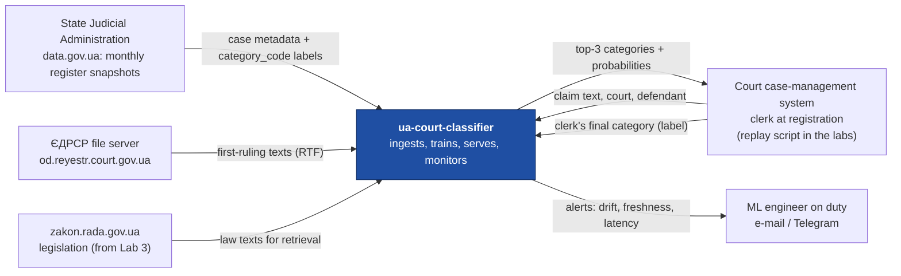
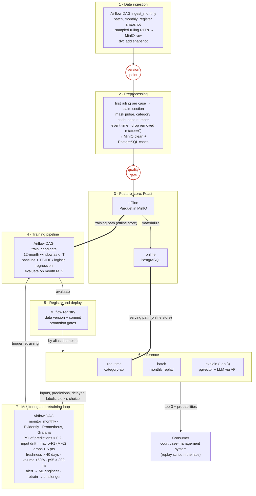
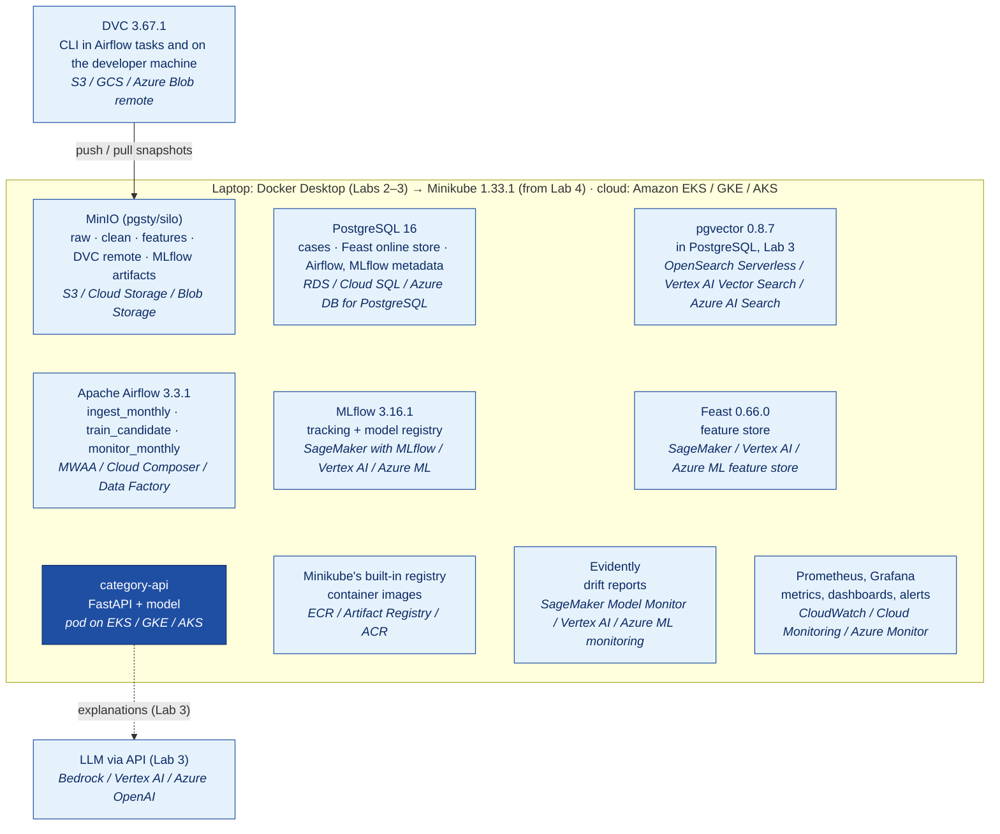

# Design document: category suggestions for new administrative court cases

> Follows the [ml-design-docs](https://github.com/eugeneyan/ml-design-docs) template. Section numbers are fixed: later labs revise sections by these numbers.
> Unknowns are written as **Assumption:** and kept until a later lab replaces them with a measurement.
> Data figures were measured on the 2021–2023 archives of the register (first-instance administrative courts) on 2026-10-18 and are reproduced by `make analysis` (see [`analysis/README.md`](../analysis/README.md)).

## 1. Overview

When a new administrative claim arrives at a Ukrainian court, a clerk assigns it a case category by hand, and the automated assignment of a judge depends on that category.
We build a system that reads the claim text at registration and suggests the three most likely categories with their probabilities; the clerk confirms one or picks another.
Real claims are not public, so the model learns from the first ruling of each case in the Unified State Register of Court Decisions (ЄДРСР), which restates the claim and carries the official category code.
The system replays the register month by month: it ingests each new monthly snapshot, retrains, and watches for drift such as the 2022 shift in caseload after martial law began.
The desired outcome is a reproducible, monitored pipeline whose suggestions a clerk accepts without change for most cases.

## 2. Motivation

**Who consumes the predictions.** Registration clerks of first-instance administrative courts. They registered 461k new cases in 2021, 322k in 2022 and 483k in 2023 — about 1,300–1,900 per working day across all courts on average, and up to ~2,400 in peak months.

**How often.** Once per new claim, synchronously, while the clerk fills in the registration card.

**What happens when they are wrong.** A wrong category can send the case to a judge of the wrong specialization and distorts the court statistics the State Judicial Administration publishes; fixing it later costs clerk and judge time. Today about **3.6%** of cases change category during their life (cases registered in 2021–2023), which is the baseline the system must not worsen. Because the clerk confirms every suggestion, a wrong suggestion costs a few seconds of correction, not a wrong registration.

**Why a system and not a notebook.** The mix of cases moves fast: Chernobyl-related pension claims went from 8% of new cases in 2021 to 22% in 2022 and back to 11% in 2023, and claims of discharged servicemen grew from 20% to 37%. A model trained once decays within months, so it needs scheduled ingestion, retraining, comparison with the current model and monitoring — the five labs of this course.

## 3. Success metrics

| Layer | Metric | Target | Notes |
|---|---|---|---|
| Business | Share of suggestions the clerk accepts as top-1 without change | **≥ 80%** (**Assumption:** measurable only in production; in the replay, top-1 accuracy is its proxy) | Guardrail: share of cases whose category is changed later stays **≤ 3.6%** (today's level) |
| Model | Macro-F1 over the 20 classes + "other" on the newest fully-labelled month | **≥ 0.70** (**Assumption:** recalibrated after the Lab 2 baseline) and **≥ baseline + 0.10** | Optimizing metric |
| Model | Top-3 accuracy | **≥ 0.95** | Satisficing metric: the clerk sees three options |
| System | p95 latency of `category-api` | **≤ 300 ms** | Satisficing |
| System | Freshness: model trained on data no older than | **45 days** after a snapshot is published | Monthly cadence of the source |
| System | Availability in working hours (Mon–Fri 08:00–18:00 Kyiv) | **≥ 99.5%**, fallback to the rule baseline | Suggestions are advisory and never block registration |

## 4. Requirements and constraints

### Functional requirements

| # | Requirement |
|---|---|
| F1 | **Input:** the claim text, the receiving court's code and the defendant's name, sent by the court's case-management system when a clerk opens a registration card. |
| F2 | **Output:** the top-3 categories (`category_code`, name, probability), the model version, and a `fallback` flag when the rule baseline answered. |
| F3 | **Caller:** the case-management system on the clerk's behalf; in this project, a replay script that sends cases in order of their event time. |
| F4 | The clerk's final choice is logged with the suggestion, giving a label on a real claim. |
| F5 | Each monthly snapshot of the register is ingested, versioned, validated and turned into a training set without manual steps. |
| F6 | A new model is trained, compared with the current one on the newest fully-labelled month, and promoted only through the gates in §5.4. |

### Non-functional requirements

| Category | Requirement |
|---|---|
| Freshness | The source publishes a full snapshot of each year **monthly**. A snapshot is ingested within **2 days** of publication and the model is retrained monthly; the serving model is never older than **45 days** of data. |
| Latency and throughput | p95 ≤ **300 ms** per request. Average load is ~4–5 requests/min (up to 2,400 cases per working day over 10 hours); sized for **10 requests/s** peak (**Assumption:** registrations bunch in the morning; 100× headroom). |
| Availability and fallback | ≥ **99.5%** in working hours. If the model fails to load or answer within 300 ms, `category-api` answers from the rule baseline (§5.3) with `fallback=true`; if the whole service is down, the clerk categorizes manually, as today. |
| Reproducibility | Every registered model points to the DVC version of its snapshot, the git commit and its parameters in MLflow; `make setup` rebuilds the environment from `uv.lock`; random seeds are fixed. |
| Adaptability | New data enters as a monthly snapshot through the ingestion DAG. New models enter as challengers and are promoted by alias (§5.4). A category not in the 20 classes maps to "other" until it reaches **200** cases in 12 months (**Assumption**); only 5 such categories (13 cases) appeared in 2022. |
| Observability without ground truth | Labels reach the pipeline only when the first ruling is published (p50 3 days, p90 5–47 days in 2022–2023) and the next monthly snapshot arrives. Until then we monitor input descriptors (text length, out-of-vocabulary share, defendant type, court mix), the distribution of predicted categories (PSI) and mean top-1 confidence. Accuracy for month M is computed after the snapshot of month M+2. |
| Cost and resource ceilings | Local: runs on a 16 GB laptop, Minikube at 4 GB, training ≤ **30 min** on CPU. Cloud (eu-central-1): ceiling **$300/month** for the lean variant (estimated $286), ≈ **$1,574/month** for the fully managed reference (§6.7). |

### 4.1 In scope and out of scope

**In scope:** first-instance administrative courts; Ukrainian-language text; the 20 most frequent categories of 2021 plus "other"; a replay of 2021–2023; advisory top-3 suggestions; ingestion, training, serving, monitoring and the LLM and agent extensions of Labs 3–5.

**Out of scope:** civil, criminal and commercial cases; appeal and cassation courts; predicting the outcome of a case; integration with a real court system and processing of real, non-public claims; scanned documents (OCR); individual classes for the long tail of ~130 rare categories.

## 5. Methodology

### 5.1 Problem statement

Single-label multi-class **text classification**: given the claim text at registration, predict `category_code` among the 20 most frequent categories of 2021 plus "other", returning calibrated probabilities for the top 3. The 20 classes cover 86–89% of cases in each of 2021–2023, so "other" holds 11–14%.

**Rejected framing: flat classification over all ~150 categories.** Most of them have a few dozen cases a year, too few to learn or to evaluate per class, and the clerk gains little from a suggestion that is rarely right. The long tail stays inside "other", where the clerk chooses manually, as today.

### 5.2 Data

**Source.** ЄДРСР open data on data.gov.ua, published by the State Judicial Administration: one archive per year (2006–2026 are available), refreshed monthly, each holding `documents.csv` (one row per court document: `doc_id`, `court_code`, `judgment_code`, `justice_kind`, `category_code`, `cause_num`, `adjudication_date`, `receipt_date`, `doc_url`, `status`, `date_publ`) and dictionaries. Texts are RTF files (cp1251) behind `doc_url`.

**Unit and input.** The register holds court documents, not claims. We group documents by case number (`cause_num`) and keep the **earliest published document of each case**, which is a ruling (ухвала) opening proceedings or leaving the claim without motion in **99.9%** of cases. Its section after "встановив" (found in all 299 rulings of a random sample) restates the claim's demands almost verbatim; that section, cleaned, is the model input.

**Time.** The register has no registration date. We keep three timestamps:

| Timestamp | Source | Used for |
|---|---|---|
| Event time ≈ filing | The filing date stated in the ruling ("23.05.2022 до суду надійшов позов"), extractable in **32%** of rulings; otherwise `adjudication_date` of the first ruling. Where both exist, the median gap is **5 days**. Case numbers are assigned at registration and their order matches the order of first-ruling dates (Spearman **0.998**). | Monthly batches, time split, drift windows |
| Availability time | `date_publ` of the first ruling (p50 3 days after the ruling; p90 5–47 days in 2022–2023) | A training set "as of T" contains only cases published by T |
| Label time | Production: at registration (clerk). Replay: equal to availability time | Monitoring with delayed labels |

**Labels.** `category_code` is assigned by the clerk at registration and copied to every document of the case. It is noisy: 3.6% of cases carry more than one category over their life. We use the category on the first ruling, which is the decision we automate.

**Serving time vs training time.** At serving time the system sees the real claim, the court and the defendant. At training time it sees the judge's restatement of the claim. Fields that exist only after registration are excluded: the judge (assigned by automated distribution *from* the category), the procedure type, and anything from later documents.

**Sampling.** Metadata for all cases (1.27M in 2021–2023) is ingested monthly and used for the label distribution and volume monitoring. Texts are downloaded for a stratified sample of **2,000 cases per month** (**Assumption:** ~5% of volume keeps downloads polite to the court server and the dataset laptop-sized: ~25 KB per ruling, ~0.6 GB per year).

**Formats.** Raw: the snapshot archive as published (immutable, versioned with DVC). Clean: Parquet partitioned by event month. Features: Parquet in the Feast offline store, PostgreSQL in the online store. The `cases` table in PostgreSQL serves monitoring queries.

**Data checklist.**

| Item | Justification |
|---|---|
| Time axis | Every case has an event time (filing date or first-ruling date), so the data splits into monthly batches; Lab 2 ingests "the next month" and Lab 4 replays 2022 as drift. |
| Enough history | 2006–2026 are published; we use 2021–2023 (1.27M cases). Train on Jan–Sep 2021, validate on Oct–Dec 2021, test on Jan–Feb 2022, and replay Mar 2022–Dec 2023 (22 months) as production. |
| Labels with a known delay | Production: immediate (the clerk). Replay: the label arrives with the first ruling's publication (p50 3 days, p90 5–47 days) plus up to one month until the next snapshot. |
| Text surface / corpus | The task is text: the rulings themselves. For Lab 3 retrieval: the Code of Administrative Procedure (КАС), the laws most cited by the top categories (pension provision of discharged servicemen, the Chernobyl status law, the Tax Code) from zakon.rada.gov.ua, and the category dictionary `cause_categories.csv`. |

### 5.3 Techniques

**Baseline (rule).** Extract the defendant from the opening sentence of the claim ("до <defendant> про …"), map it to a defendant type (pension fund, tax service, police, territorial recruitment centre, local council, …) with keyword rules, and predict the categories most frequent for that type in the last 12 months. It is also the runtime fallback.

**Candidate.** TF-IDF on word 1–2-grams and character 3–5-grams of the claim section, plus the features below, into multinomial logistic regression with class weights and probability calibration. It is fast on CPU (well under the latency budget) and easy to reproduce. The vectorizer is part of the model artifact, so text processing is identical in training and serving.

**Features.**

| Feature | Training-time source | Serving-time source |
|---|---|---|
| `claim_text` | Claim section of the first ruling, with judge names, the category code (present in the text of **13.4%** of rulings), the case number and procedural boilerplate masked | Claim text in the registration request |
| `defendant_type` | Rules over the ruling's opening sentence | Defendant field of the registration card |
| `court_code`, `region` | `court_code` in metadata | The receiving court, known to the caller |
| `court_category_prior_90d` | Feast offline store, point-in-time join on event time | Feast online store, materialized daily |
| *excluded:* judge, procedure type, later documents | — | Not available at registration; the judge also leaks the label |

### 5.4 Experimentation and validation

**Split by time, never at random.** Train Jan–Sep 2021, validation Oct–Dec 2021 (model selection), test Jan–Feb 2022, all by event time. Each set contains only cases published by its cut-off date, so a slow-to-publish case cannot leak into an earlier set. A random split would mix 2022 claims into training and hide the drift the system exists to handle.

**Offline metric.** Macro-F1 over 21 classes (optimizing), top-3 accuracy and per-class recall (satisficing).

**New vs current model.** Every month, the challenger (trained on the last 12 months) and the champion are scored on the newest fully-labelled month (M−2). Promote by moving the MLflow alias `champion` only if: macro-F1 ≥ champion + 0.01, no class loses more than 5 points of recall, top-3 accuracy ≥ 0.95, and p95 latency ≤ 300 ms. Otherwise the champion stays and the result is logged.

### 5.5 Human in the loop

- **Override:** the clerk always sees top-3 and can pick any category from the full list. The pick is logged as the label and as a business-metric event.
- **Drift alert:** reviewed by the ML engineer on duty (the author), who decides between "real shift — retrain", "data bug — fix ingestion" and "noise — raise the threshold", and records the decision in the alert ticket.
- **Promotion:** automated gates (§5.4) propose; the ML engineer approves after looking at the confusion matrix of the changed classes.
- **Kill switch:** the head of the court office can turn suggestions off (a flag in `category-api`), returning to manual categorization.

## 6. Implementation

### 6.1 High-level design

The three diagrams use the component names of §6.2; Mermaid sources are kept here so the diagrams change together with the text.

**System context.** The system is one box; everything around it belongs to someone else. In the replay, labels come from the register metadata; in production they come back from the clerk.

**Data flow on the seven layers.** The three marks:

- **Version point** — after ingestion, each monthly snapshot is added to DVC (remote on MinIO) before anything reads it, so every model can name the exact snapshot it was trained on.
- **Quality gate** — between preprocessing and the feature store: schema of `documents.csv`, impossible dates (a ruling dated before its case was registered), leakage (`категорія <digits>` left in the text), and batch volume vs the previous month. A failed gate stops the run before the feature store changes.
- **Where training and serving diverge** — at the feature store: training reads the offline store (point-in-time joins on event time), `category-api` reads the online store. The batch replay also reads point-in-time features from the offline store.

**Deployment, first draft.** Every component we run locally, with its managed equivalent in italics (AWS / GCP / Azure). Lab 4 replaces this with the real cluster topology.

### 6.2 Infra

Local stack from the course reference table; the cloud columns name the managed service we would use instead.

| Component | Local (lab) | AWS | GCP | Azure | From |
|---|---|---|---|---|---|
| Object storage, data lake (`raw`, `clean`, `features`, artifacts) | MinIO (`pgsty/silo`) | Amazon S3 | Cloud Storage | Blob Storage | Lab 2 |
| Data versioning remote | DVC 3.67.1 + dvc-s3, remote on MinIO | S3 remote | GCS remote | Azure Blob remote | Lab 2 |
| Warehouse, serving database (`cases` table, Feast online store) | PostgreSQL 16 | Amazon RDS | Cloud SQL | Azure Database for PostgreSQL | Lab 2 |
| Orchestrator (DAGs `ingest_monthly`, `train_candidate`, `monitor_monthly`) | Apache Airflow 3.3.1, LocalExecutor | Amazon MWAA | Cloud Composer | Azure Data Factory | Lab 2 |
| Experiment tracking and model registry | MLflow 3.16.1 (PostgreSQL backend, MinIO artifacts) | SageMaker with MLflow | Vertex AI Experiments and Model Registry | Azure ML with MLflow | Lab 2 |
| Feature store | Feast 0.66.0 | SageMaker Feature Store | Vertex AI Feature Store | Azure ML managed feature store | Lab 2 |
| Vector store (legal corpus) | pgvector 0.8.7 | OpenSearch Serverless vector search | Vertex AI Vector Search | Azure AI Search | Lab 3 |
| LLM inference (explanations) | LLM via API | Amazon Bedrock | Vertex AI generative AI | Azure OpenAI | Lab 3 |
| Container registry | Minikube's built-in registry | Amazon ECR | Artifact Registry | Azure Container Registry | Lab 4 |
| Kubernetes cluster (runs `category-api`) | Minikube 1.33.1 | Amazon EKS | GKE | AKS | Lab 4 |
| Model service `category-api` (FastAPI + model) | Pod on Minikube | Pod on EKS | Pod on GKE | Pod on AKS | Lab 4 |
| Model and data monitoring | Evidently | SageMaker Model Monitor | Vertex AI Model Monitoring | Azure ML model monitoring | Lab 4 |
| Metrics store and dashboards | Prometheus, Grafana | Amazon CloudWatch | Cloud Monitoring | Azure Monitor | Lab 4 |

Where it runs: in Labs 2–3 these components run as containers on Docker Desktop on the laptop; from Lab 4 they move into Minikube (cloud: Amazon EKS / GKE / AKS). DVC is a CLI, not a service: it runs inside Airflow tasks and on the developer machine.

Not needed: Kafka and Spark — the source publishes monthly, and peak load is ~10 requests/s.

### 6.3 Performance

**Online for the consumer, batch for the replay.** The clerk waits for the suggestion while filling in the card, so `category-api` answers synchronously (p95 ≤ 300 ms; the p90 ruling is ~9,400 characters, and TF-IDF + logistic regression scores it in milliseconds). Batch scoring of a monthly batch (10k–56k cases, minutes on CPU) is used for the replay, backfills and monitoring. Throughput target: 10 requests/s on one replica (**Assumption:** confirmed by a load test in Lab 4).

### 6.4 Security

Secrets (MinIO, PostgreSQL, LLM API key) live in a git-ignored `.env` locally, Kubernetes Secrets in Lab 4, and AWS Secrets Manager in the cloud variant. `category-api` is reachable only from the court network with an API key per calling system (**Assumption**); MinIO, PostgreSQL, MLflow and Airflow are not exposed outside the cluster.

### 6.5 Data privacy

The register depersonalizes parties (`ОСОБА_1`, `АДРЕСА_1`), but judges and organisations are named and depersonalization is imperfect. We store only the masked claim section and metadata, drop judge names, and keep raw RTF files for at most 24 months (**Assumption**). The readme obliges users to propagate removals: documents with `status=0` are deleted from `clean` and the features at the next ingestion. A production system would receive real, non-depersonalized claims, so it must run inside the court's infrastructure, and request logs keep a hash of the text, not the text.

### 6.6 Monitoring and alarms

| What | Metric | Fires when | Receiver |
|---|---|---|---|
| Service | p95 latency, error rate, fallback rate | p95 > 300 ms for 15 min; errors > 1%; fallback > 5% | ML engineer (Grafana alert → e-mail/Telegram) |
| Prediction drift | PSI of predicted categories vs the trailing 3 months; mean top-1 confidence | PSI > 0.2 | ML engineer |
| Input drift | Evidently text descriptors: length, out-of-vocabulary share, defendant-type mix, court mix | Drift detected on ≥ 2 descriptors | ML engineer |
| Pipeline freshness | Newest event date in `cases`; snapshot checksum vs the previous run | Newest event older than 40 days, or the same snapshot read twice | ML engineer |
| Batch volume | New cases this month vs the previous month | Change > 50% (March 2022 would have fired: 38k → 10k) | ML engineer |
| Delayed accuracy | Macro-F1 and top-3 accuracy of month M−2 | Macro-F1 drops > 5 points vs the value at promotion → trigger `train_candidate` | ML engineer |

Every request logs: request id, timestamp, court, input length, out-of-vocabulary share, top-3 with probabilities, model version, latency, fallback flag.

### 6.7 Cost

Monthly estimate of the AWS column in **eu-central-1 (Frankfurt)**, the region closest to Ukraine, at on-demand list prices, built in the AWS Pricing Calculator on 2026-10-25: [saved estimate](https://calculator.aws/#/estimate?id=98c1b7a99864181094bb2a2c73891e16896c7421). The calculator counts 730 hours per month, except the MLflow server (24 h × 30 days).

**Usage assumptions.** ~40k new cases per month (2023 average); explanations requested for ~9% of them (3.6k/month: 1 request per minute for 2 hours a day, ~3,000 input and ~300 output tokens each); 60 GB in object storage; services run 24/7; no free tier, reservations or savings plans.

| Service | Configuration and unit price | $/month |
|---|---|---|
| Amazon MWAA | Small environment, $0.49/h (the smallest class in the calculator): 2 schedulers, 1–2 workers, 2–3 web servers, 0 h at maximum; 10 GB metadata, $0.10/GB-month | 358.70 |
| SageMaker with MLflow | Small tracking server 24 h × 30 days, $0.886/h; 1 GB storage | 638.04 |
| OpenSearch Serverless (vector) | 0.5 indexing + 1 search OCU (the calculator's minimum for search), $0.339/OCU-hour; 1 GB index | 371.23 |
| Amazon EKS | 1 cluster, $0.10/h | 73.00 |
| Amazon EC2 (EKS nodes) | 2 × t3.medium Linux on-demand, $0.048/h | 70.08 |
| Amazon RDS for PostgreSQL | db.t4g.micro Single-AZ, $0.019/h + 20 GB gp3, $0.137/GB-month | 16.61 |
| Amazon Bedrock | Pixtral Large 25.02 (**Assumption:** the model is chosen in Lab 3): 10.8M input tokens, $0.002/1K + 1.08M output tokens, $0.006/1K | 28.08 |
| Amazon CloudWatch | 20 metrics, $0.30; 5 GB logs, $0.63/GB + 1-month storage; 10 standard alarms, $0.10; 1 dashboard | 10.17 |
| SageMaker Processing (Model Monitor) | 30 jobs × 1 h on ml.m5.large + 1 GB gp2 | 4.26 |
| SageMaker Feature Store | Standard online store: 25k writes, $1.525/M + 40k reads, $0.305/M + 1 GB, $0.5508/GB-month | 0.60 |
| Amazon S3 | 60 GB Standard, $0.0245/GB-month | 1.47 |
| AWS Secrets Manager | 4 secrets, $0.40 each | 1.60 |
| Amazon ECR | 3 GB of images, $0.10/GB-month | 0.30 |
| **Total, fully managed** | | **1,574.14** |

Left out of the calculator estimate, each under $4: node disks (2 × 20 GB gp3, $3.81) and Titan text embeddings for retrieval (1.8M tokens, $0.36).

**Where the calculator overstates.** It has no mw1.micro class (sold in Frankfurt at $0.29/h: −$146) and no 0.5 search OCU (the dev/test minimum: −$124). Mistral Large 3 ($0.0006/$0.0018 per 1K tokens) is sold in Frankfurt but is not yet in the calculator (−$20).

**Lean variant: ≈ $286/month**, derived from the same estimate. Airflow and MLflow are self-hosted on one extra t3.large node ($0.096/h, +$70.08), and pgvector on a db.t4g.small RDS instance ($0.037/h, 30 GB: $31.12 instead of $16.61) replaces OpenSearch Serverless. Evidently and Feast run on the cluster instead of SageMaker Processing and Feature Store. EKS, Bedrock, CloudWatch, S3, Secrets Manager and ECR are unchanged.

**What drives the cost.** The three always-on managed control planes (the MLflow tracking server, OpenSearch Serverless, MWAA) are $1,368, or 87% of the managed total. The model itself, a CPU pod and ~$28 of LLM tokens, is almost free. The cheapest levers, in order:
1. Run the MLflow tracking server only around the monthly training window (~72 h): −$574.
2. Replace OpenSearch Serverless with pgvector: −$357 net of the larger RDS instance.
3. Self-host Airflow on the extra node: −$289 net.

The usage-driven lines are small, so a large error would most likely come from LLM volume: explanations for every case with the full ruling text (~10k input tokens) would raise Bedrock from $28 to ~$870.

### 6.8 Integration points

| Party | Role | Contract |
|---|---|---|
| State Judicial Administration (ДСА) via data.gov.ua | Upstream data owner | Yearly archives, tab-separated UTF-8, schema in `readme_<year>.pdf`, monthly refresh, **no SLA**. We pin the schema and fail the run on any change (§6.9). |
| Court case-management system | Downstream consumer (hypothetical) | `POST /v1/suggest` `{claim_text, court_code, defendant}` → `{top3: [{category_code, name, probability}], model_version, fallback}`; p95 ≤ 300 ms; advisory only. The clerk's final choice comes back through `POST /v1/feedback`. |
| zakon.rada.gov.ua | Upstream for the Lab 3 legal corpus | Public law texts; re-fetched when a law changes; version recorded per index build. |

### 6.9 Risks and uncertainties

| Risk | Mitigation |
|---|---|
| Training–serving skew: the model trains on the judge's restatement and serves on real claims | Train only on the claim section; start production in shadow mode and compare with clerks' choices before showing suggestions; monitor input descriptors against the training set. |
| Label leakage through the text: the category code is in 13.4% of rulings, judge names in 97% | Mask both in preprocessing; the quality gate fails the run if `категорія <digits>` survives. |
| Label noise: 3.6% of cases change category | Report metrics also on cases with a stable category; keep the noisy share on a dashboard. |
| Prior shift (Chernobyl claims 8% → 22% → 11%) | Monthly retraining on a 12-month window, class weights, PSI alert on predicted categories. |
| Source outage or late refresh (e.g., planned register downtime on 2 Dec 2025) | Idempotent ingestion keyed by snapshot checksum; freshness alarm; serving continues on the last good model. |
| Silent schema change in `documents.csv` | Schema check in the quality gate fails the run before anything downstream changes. |
| Load on the court server while downloading texts | Sample 2,000 cases per month, ≤ 3 requests/s, cache every file in MinIO. |
| The filing date is in only 32% of rulings | Fall back to the first-ruling date (median 5 days later) and document the bias in §5.2. |

## 7. Appendix

### 7.1 Alternatives

| Alternative | Pros | Cons | Decision |
|---|---|---|---|
| Final decisions instead of first rulings as input | Longer texts, more context | Contain the outcome (leakage) and appear months after filing, misaligning the time axis with registration | Rejected |
| Zero-shot LLM classification from category descriptions | No training; can name new categories | ~1 s+ per call, per-token cost, non-deterministic, harder to version and compare | Rejected as the classifier; an LLM explains suggestions in Lab 3 |
| Fine-tuned multilingual transformer | Likely higher macro-F1 on paraphrased claims | Needs a GPU, slower to serve and retrain monthly | Deferred; can enter later as a challenger through the same gates |
| Streaming ingestion (Kafka) | Lower data latency | The source publishes monthly snapshots; nothing to stream | Rejected |

### 7.2 Experiment results

_Placeholder — filled in Lab 2._

### 7.3 Performance benchmarks

_Placeholder — filled in Lab 4._

### 7.4 Milestones

- **Lab 2:** an Airflow DAG ingests each monthly snapshot into MinIO with a DVC version, runs the quality gate, and trains the baseline and the TF-IDF model, tracked and registered in MLflow with data version and commit.
- **Lab 3:** a retrieval component over the КАС and the key laws in pgvector explains each suggestion with cited articles, with an evaluation set and per-run cost and latency.
- **Lab 4:** `category-api` and the Feast online store run on Minikube; Evidently, Prometheus and Grafana watch the 2022 replay, and the March 2022 shift (replayed as it happened, or injected on demand) reaches the ML engineer as an alert.
- **Lab 5:** an agent for the clerk takes a claim, calls `category-api` and the explanation service, finds similar past cases and drafts the registration card, with traces and a ten-task evaluation.
